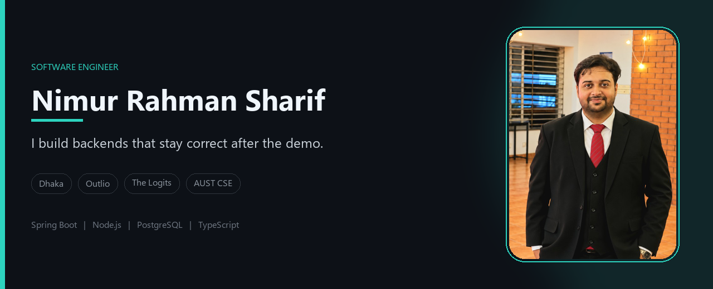
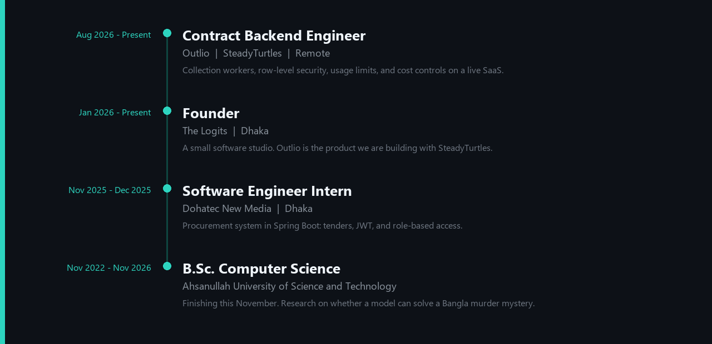
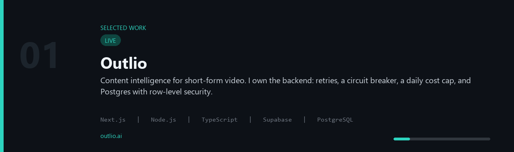

 

## About

I am Nimur Rahman Sharif. On GitHub, Tasrik.

I build the part of a product that has to stay correct after launch: authenticated APIs, usage limits, and queries that belong in the database. When the team is small, I ship the interface too.

I founded [The Logits](https://www.linkedin.com/company/the-logits-ai). Through that work I am the contract backend engineer on [Outlio](https://outlio.ai) for SteadyTurtles. Outlio watches TikTok, Instagram, and YouTube, finds posts that beat an account's own average, and turns them into scripts and a content plan.

I am finishing a B.Sc. in Computer Science and Engineering at Ahsanullah University of Science and Technology. I am open to a junior software engineer role on a team that treats the backend as the product.

## Experience

## Selected work

The reel below advances on its own. Each title underneath opens the live product or the repository.

| | | |
| --- | --- | --- |
| **[Outlio](https://outlio.ai)** live | **[Procurement System](https://github.com/shariftasrik/My_Internship_Dohatec)** | **[AUST CSE Society](https://github.com/shariftasrik/aust-cse-society)** |
| **[Text-to-SQL](https://github.com/shariftasrik/text-to-sql)** | **[EPZExport](https://github.com/shariftasrik/EPZExport)** | **[Cravings](https://cravings-tasrik.42web.io/)** live demo |

Also on GitHub: [CPU Scheduling Simulator](https://cpu-scheduling-simulator-tasrik.vercel.app/) live, [portfolio](https://github.com/shariftasrik/portfolio), [dev_documentation](https://github.com/shariftasrik/dev_documentation), [NeetCode submissions](https://github.com/shariftasrik/neetcode-submissions).

## Contributions

 

 

 

## Stack

<picture>
  <source media="(prefers-color-scheme: dark)" srcset="https://skillicons.dev/icons?i=java,spring,nodejs,ts,js,react,nextjs,angular,python,pytorch,postgres,supabase,mysql,mongodb,cs,dotnet,php,tailwind,cpp,c,laravel,huggingface,git,postman&perline=8&theme=dark">
  
</picture>

**Languages.** Java, C#, TypeScript, JavaScript, Python, C, C++, SQL.

**Backend.** Spring Boot, Spring Security, Spring Data JPA, Node.js, Express, ASP.NET Core, Laravel, REST, Supabase.

**Frontend.** Next.js, React, Angular, Tailwind CSS, Framer Motion, Three.js.

**Data.** PostgreSQL, MySQL, MongoDB, SQL Server.

**AI.** PyTorch, Hugging Face Transformers, T5, scikit-learn.

**Tools.** Git, IntelliJ IDEA, VS Code, Postman, Swagger, Vercel, Sentry.

## Research

**Bangla murder-mystery reasoning.** November 2025 to present.

I am testing whether a model can read an entire Bangla murder mystery and name the murderer and the victim. The path runs from a scanned page through Bengali OCR, speaker-safe chunking, and retrieval, to a timeline and a score for each suspect. OCR word error rate was 4.3%. On 62 characters, role F1 and identity F1 were both 1.00.

## Contact

Dhaka, Bangladesh.

- Email: [shariftasrik12@gmail.com](mailto:shariftasrik12@gmail.com)
- Portfolio: [portfolio-tasrik.vercel.app](https://portfolio-tasrik.vercel.app/)
- LinkedIn: [Nimur Rahman Sharif](https://www.linkedin.com/in/nimur-rahman-sharif-946108349/)
- Product: [outlio.ai](https://outlio.ai)

If you are hiring for backend or full-stack work, in Dhaka or remote, write to me.
