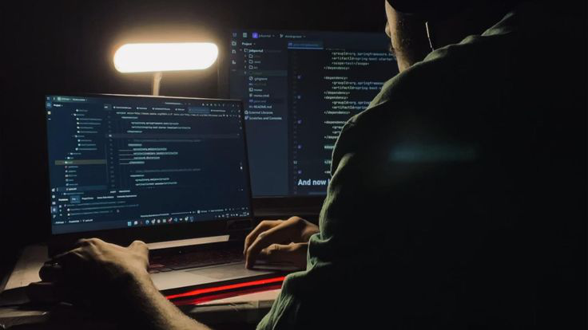
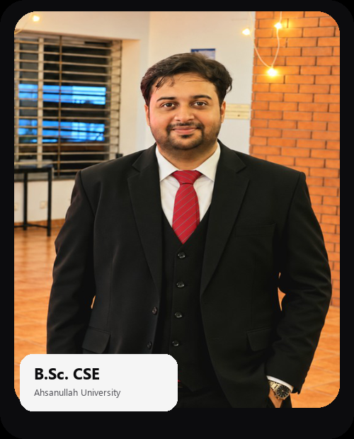
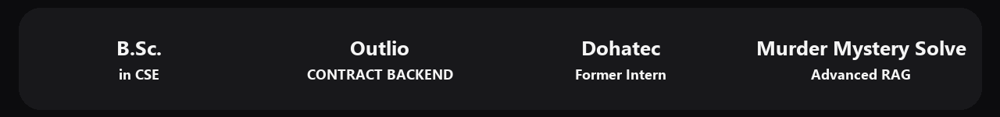
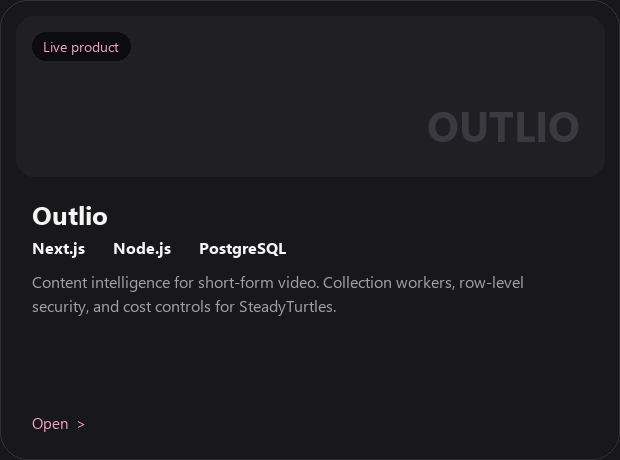
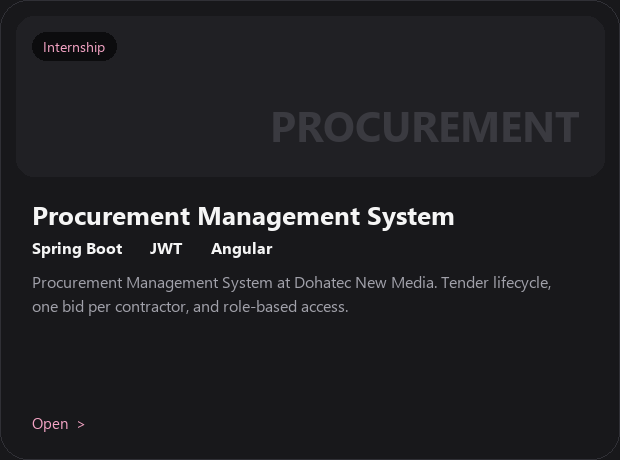
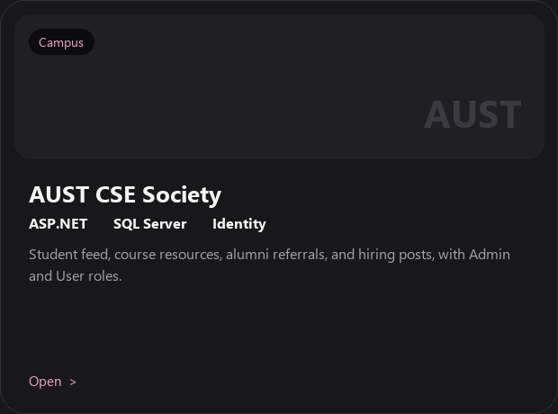
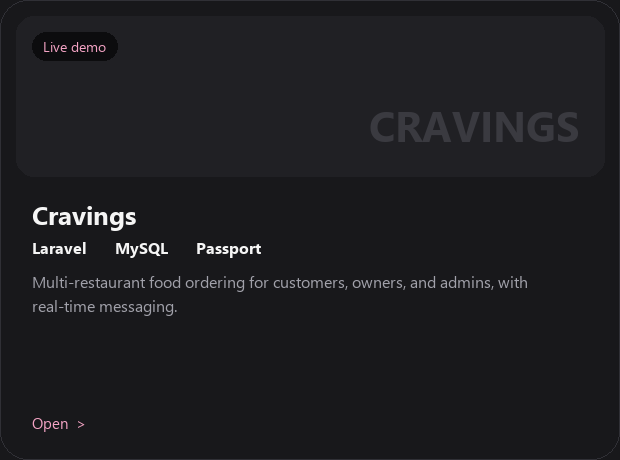
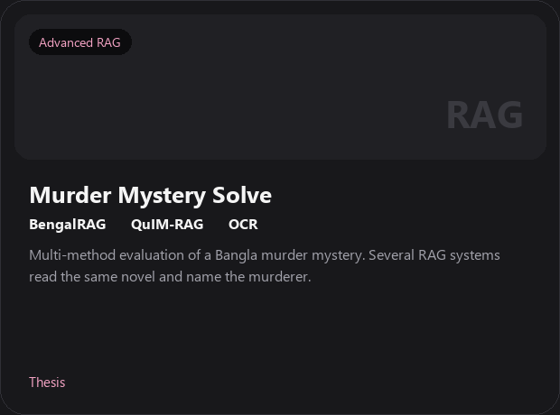

<table>
<tr>
<td width="58%" valign="center">

**SOFTWARE ENGINEER**

# Software people can rely on.

I am Nimur Rahman Sharif, a software engineer in Dhaka. I build APIs, data layers, and the product around them, and I ship that work to production.

 

</td>
<td width="42%" valign="center">

</td>
</tr>
</table>

## About

<table>
<tr>
<td width="58%" valign="middle">

### I build software that people can trust in production.

I am Nimur Rahman Sharif (Tasrik). I turn complex product ideas into production-ready software, combining Generative AI, RAG pipelines, and intelligent automation with secure APIs, scalable backend systems, and intuitive web applications. From architecture to deployment, I engineer the complete system, not just the AI feature.

From August to September 2026 I was the contract backend engineer on [Outlio](https://outlio.ai) for SteadyTurtles. Before that I completed my internship at Dohatec New Media, where I was under the supervision of the Procurement Management System (e-GP) team.

I hold a B.Sc. in Computer Science and Engineering from Ahsanullah University of Science and Technology.

</td>
<td width="42%" valign="middle">

</td>
</tr>
</table>

## Projects

<table>
<tr>
<td width="50%" valign="top">

</td>
<td width="50%" valign="top">

</td>
</tr>
<tr>
<td width="50%" valign="top">

</td>
<td width="50%" valign="top">

</td>
</tr>
<tr>
<td width="50%" valign="top">

</td>
<td width="50%" valign="top">

**Outlio** is the live product. **Procurement Management System**, **AUST CSE Society**, and **Cravings** open from the cards. **Murder Mystery Solve** is the thesis: an advanced RAG evaluation with no public repository yet.

</td>
</tr>
</table>

## Work

Open a group to see the names and links.

<b>Full Stack Software Development</b>

- [Procurement Management System](https://github.com/shariftasrik/My_Internship_Dohatec)
- [AUST CSE Society](https://github.com/shariftasrik/aust-cse-society)
- [Cravings](https://github.com/shariftasrik/Cravings) - [live demo](https://cravings-tasrik.42web.io/)
- [Portfolio](https://portfolio-tasrik.vercel.app/)
- [Tender management system](https://github.com/shariftasrik/tender_management_system)
- [Tender management system, MERN](https://github.com/shariftasrik/tender-management-system)
- [my-finance](https://github.com/shariftasrik/my-finance)
- [Expense tracker](https://github.com/shariftasrik/expense_tracker)
- [CPU Scheduling Simulator](https://github.com/shariftasrik/cpu-scheduling-simulator) - [live](https://cpu-scheduling-simulator-tasrik.vercel.app/)
- [CineRental](https://github.com/shariftasrik/CineRental) - [live](https://cine-rental-rosy.vercel.app)
- [PDF Extractor](https://github.com/shariftasrik/pdf_extractor) - [live](https://pdf-extractor-tasrik.vercel.app/)
- [Edu-Aid](https://github.com/shariftasrik/Edu-Aid) - [live](https://edu-aid.vercel.app/)
- [Orbit Atlas](https://github.com/shariftasrik/CG_Lab_Project) - [live](https://orbit-atlas-opal.vercel.app)
- [QuickNote](https://github.com/shariftasrik/QuickNote)
- [Todo List](https://github.com/shariftasrik/todo_list) - [live](https://todo-list-inky-mu-94.vercel.app)
- [Tic-Tac-Toe](https://github.com/shariftasrik/Tic-Tac-Toe) - [live](https://tic-tac-toe-nine-alpha-67.vercel.app)
- [Angela Yu assignments](https://github.com/shariftasrik/Angela-Yu-s-Assignment-Submission)

<b>Full Stack GenAI Development</b>

- [Outlio](https://outlio.ai) - backend for SteadyTurtles
- [BrainCom](https://github.com/shariftasrik/BrainCom)
- [Logits](https://logits-ai.com)

<b>AI/ML</b>

- Murder Mystery Solve - advanced RAG evaluation of a Bangla murder mystery (thesis)
- [Text-to-SQL](https://github.com/shariftasrik/text-to-sql)
- [SQL vs document RAG](https://github.com/shariftasrik/sql_vs_document_RAG)
- [EPZExport](https://github.com/shariftasrik/EPZExport)
- [Breast cancer classification](https://github.com/shariftasrik/ml-binary-classification-breastcancer)
- [Face mask detection](https://github.com/shariftasrik/face_mask_detection)

<b>Problem Solving</b>

- [NeetCode submissions](https://github.com/shariftasrik/neetcode-submissions)
- [dev_documentation](https://github.com/shariftasrik/dev_documentation)

## Statistics

 

 

## Contact

### Let's build something that lasts.

Dhaka, Bangladesh.

- Email: [shariftasrik12@gmail.com](mailto:shariftasrik12@gmail.com)
- Portfolio: [portfolio-tasrik.vercel.app](https://portfolio-tasrik.vercel.app/)
- LinkedIn: [Nimur Rahman Sharif](https://www.linkedin.com/in/nimur-rahman-sharif-946108349/)
- Startup: [Logits](https://logits-ai.com)

If you are hiring for backend or full-stack work, in Dhaka or remote, write to me.
